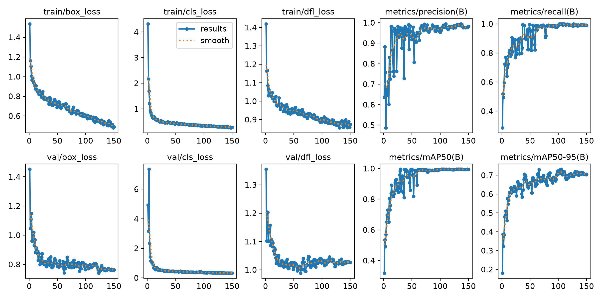
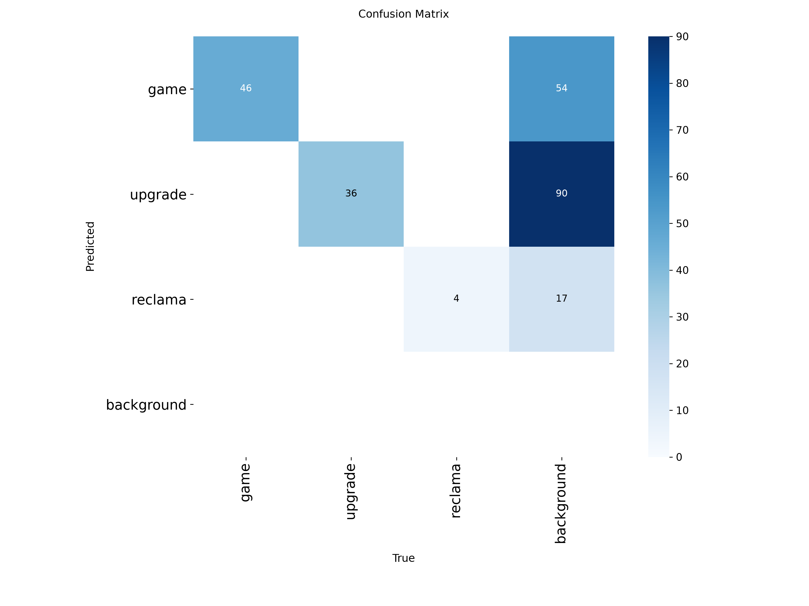

# 🍪 ONNX Cookie Clicker Bot

Минималистичный и сверхбыстрый бот для автоматизации Cookie Clicker. Работает на кастомной нейросети **YOLOv8**, но использует **OpenCV DNN** для инференса. Никакого тяжелого PyTorch — только чистый ONNX и скорость.

<p align="center">
  
  
  
  
</p>

## 📊 Результаты обучения
Модель обучена на кастомном датасете (3 класса: `game`, `upgrade`, `reclamd`). Достигнута высокая точность (mAP50 > 0.95) без переобучения.

<p align="center">
  
  
</p>

## ✨ Особенности
*   ⚡ **Ультра-легкий вес**: Отказ от `ultralytics` и `torch` в пользу `cv2.dnn`. Окружение занимает ~150 МБ вместо 3 ГБ.
*   🖱️ **Умный кликер**: Мгновенно распознает и кликает по печенью.
*   🛒 **Покупка улучшений**: Делает свайп снизу вверх, чтобы скупить всё, при этом настроен так, чтобы не задеть кнопку «Купить 10».
*   🚫 **Блокировщик рекламы**: Находит и закрывает всплывающие баннеры.
*   🛑 **Безопасная остановка**: Нажатие `Пробел` или увод мыши в левый верхний угол.
* яндекс игра куки кликер https://yandex.ru/games/app/cookie-clicker-old-238578

## 🚀 Быстрый старт

Следуйте этим шагам, чтобы запустить бота за пару минут (инструкция для Linux / Ubuntu / Mint).

### 1. Установка системных зависимостей
Библиотекам `pyautogui` и `pynput` нужны системные инструменты для работы с экраном и мышью:
```bash
sudo apt update
sudo apt install -y git curl build-essential python3-dev scrot python3-tk
```
### 2. Установка менеджера пакетов uv
```bash
curl -LsSf https://astral.sh/uv/install.sh | sh
```
### 3. Клонирование репозитория
```bash
git clone https://github.com/BTur99/onnxcookieclicker
cd onnxcookieclicker
```
### 4. Установка Python-зависимостей
```bash
uv sync
```
### 5. Запуск бота
```bash
uv run onnxapp.py
```